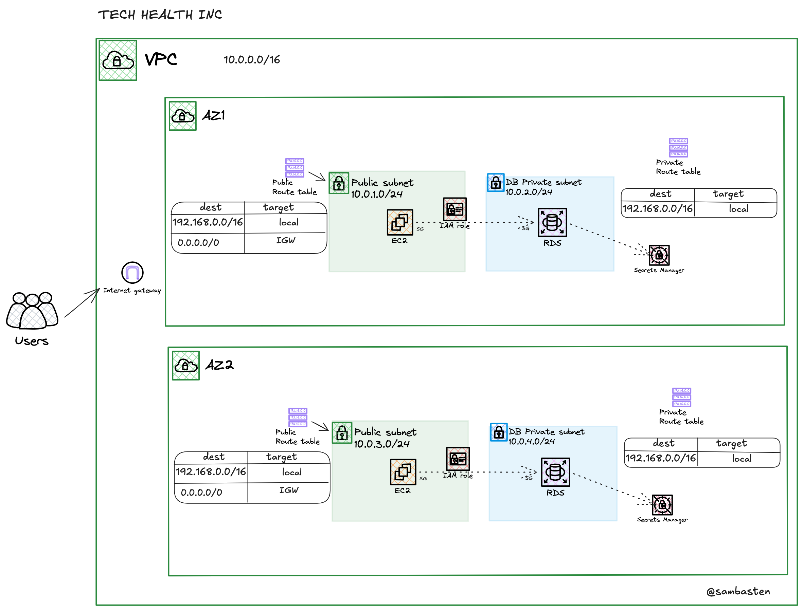

# TechHealth Inc. — Patient Portal Infrastructure Migration (AWS CDK)

Migrating TechHealth Inc.'s patient portal from a manually built, console-managed AWS environment to version-controlled **Infrastructure as Code** using **AWS CDK (TypeScript)** — with a properly segmented VPC, a private database, least-privilege security groups, and a GitHub Actions pipeline that deploys through OIDC.

---

## Table of Contents
- [The Problem](#the-problem)
- [The Solution](#the-solution)
- [Architecture](#architecture)
- [Tech Stack](#tech-stack)
- [Project Structure](#project-structure)
- [Setup & Deployment](#setup--deployment)
- [CI/CD Pipeline](#cicd-pipeline)
- [Validation & Testing](#validation--testing)
- [Design Choices](#design-choices)
- [Security Implementations](#security-implementations)
- [Cost Considerations](#cost-considerations)
- [Lessons Learned](#lessons-learned)
- [Future Improvements](#future-improvements)

---

## The Problem

TechHealth's AWS environment was built by hand in the console over five years ago. That left:

- **No version control or audit trail** for infrastructure changes.
- **High risk of human error** when rebuilding or replicating environments.
- **A weak network posture** — the database was reachable from the internet and there was little segmentation.
- **Stale documentation** that no longer matched what was running in production.

## The Solution

Everything is now defined in code and deployed by CDK:

- A new **VPC across 2 Availability Zones**, each with one public and one private subnet.
- An **EC2 web server** in a public subnet, managed through **SSM Session Manager** (no SSH port open).
- A **MySQL RDS instance** in a private, isolated subnet — no route to or from the internet.
- **Security groups** that only allow the EC2 instance to reach the database on port 3306.
- **Database credentials generated and stored in AWS Secrets Manager** — never hard-coded.
- A **GitHub Actions pipeline**: pull requests run `cdk synth` as a check, merges to `master` deploy.
- The whole environment can be **destroyed and recreated with one command**.

---

## Architecture



| Component | Placement | Details |
|---|---|---|
| VPC | `10.0.0.0/16` | 2 AZs, Internet Gateway, **no NAT Gateway** |
| Public subnets | 1 per AZ, `/24` | Route `0.0.0.0/0 → IGW` |
| Private subnets | 1 per AZ, `/24` | `PRIVATE_ISOLATED` — local VPC route only |
| EC2 | Public subnet | `t2.micro`, Amazon Linux 2023, Apache via user data |
| RDS | Private subnets (DB subnet group spans both AZs) | MySQL 8.4, `db.t3.micro`, 20 GB, encrypted |
| Secrets Manager | Regional service | Generated `admin` credentials for RDS |

**Traffic flow**

```
Users ──HTTP 80/443──▶ Internet Gateway ──▶ EC2 (public subnet, EC2 SG)
                                              │
                                              │ MySQL 3306 (allowed only from EC2 SG)
                                              ▼
                                           RDS (private isolated subnet, RDS SG)
```

- The internet can reach the EC2 instance on ports 80 and 443 only.
- The RDS security group allows inbound 3306 **only from the EC2 security group** — not from any IP range.
- The private subnets have no internet route, so the database cannot be reached from outside the VPC and cannot reach out.

> CDK assigns the `/24` subnet CIDRs automatically in order (public subnets first, then private), so the exact ranges may differ from the diagram. Check them with `npx cdk synth` or in the VPC console.

---

## Tech Stack

- **AWS CDK v2** (TypeScript) — `aws-cdk-lib`, `constructs`
- **AWS services** — VPC, EC2, RDS (MySQL), Secrets Manager, IAM, SSM, CloudFormation
- **GitHub Actions** with **OIDC** federation to AWS
- **Node.js 22**, `tsx`, Jest

---

## Project Structure

```
.
├── bin/
│   ├── techhealth-infra-migration.ts     # App entry point: infrastructure stack (used by cdk.json)
│   └── techhealth-githubrole-stack.ts    # App entry point: one-time GitHub OIDC role stack
├── lib/
│   ├── techhealth-infra-migration-stack.ts   # VPC + wires EC2 and RDS modules together
│   ├── techhealth-githubactions-stack.ts     # IAM role GitHub Actions assumes to deploy
│   ├── modules/
│   │   ├── techhealth-ec2.ts     # EC2 security group, IAM role, instance, URL output
│   │   └── techhealth-rds.ts     # RDS security group, MySQL instance, generated secret
│   └── bash-scripts/
│       └── user-data.sh          # EC2 bootstrap: installs and starts Apache
├── .github/workflows/
│   ├── dev.yaml       # On pull request: synth/validate, comment on PR
│   └── master.yaml    # On push to master (or manual run): deploy
├── TeachHealthVPC.png # Architecture diagram
└── cdk.json
```

---

## Setup & Deployment

### Prerequisites
- An AWS account and the **AWS CLI** configured (`aws configure` or SSO)
- **Node.js 22+** and npm
- The account/region **bootstrapped for CDK** (once per account/region):
  ```bash
  npx cdk bootstrap aws://<ACCOUNT_ID>/us-east-1
  ```
- For CI/CD only: the GitHub OIDC identity provider `token.actions.githubusercontent.com` must exist in IAM.

### 1. Clone and install
```bash
git clone https://github.com/sambasten/techhealth-infra-migration.git
cd techhealth-infra-migration
npm install
```

### 2. Deploy the GitHub Actions role (one time, from your machine)
GitHub Actions needs this role to deploy, so it can't deploy it itself. It lives in its own stack and entry point, so destroying the infrastructure stack never touches it.
```bash
npm run deploy-github-role-stack
```

### 3. Preview and deploy the infrastructure
```bash
npx cdk synth TechHealthInfraMigrationStack    # generate the CloudFormation template
npx cdk diff  TechHealthInfraMigrationStack    # see what will change
npx cdk deploy TechHealthInfraMigrationStack   # deploy
```
When the deploy finishes, the web server URL is printed under **Outputs** (`...PublicEC2Url = http://ec2-...amazonaws.com`).

### 4. Destroy
```bash
npx cdk destroy TechHealthInfraMigrationStack   # removes VPC, EC2, RDS, secret
npm run destroy-github-role-stack               # optional: removes the CI role
```
The RDS instance uses `RemovalPolicy.DESTROY`, so destroy leaves nothing behind (no final snapshot). That's intended for this proof of concept, not for production data.

### Useful commands
| Command | What it does |
|---|---|
| `npm run build` | Type-check the project |
| `npx cdk ls` | List stacks in the main app |
| `npx cdk synth` | Print the CloudFormation template |
| `npx cdk diff` | Compare deployed stack with local code |

---

## CI/CD Pipeline

| Workflow | Trigger | What it does |
|---|---|---|
| `dev.yaml` | Pull request opened / updated | Installs deps, assumes the AWS role via OIDC, runs `cdk synth`, comments on the PR |
| `master.yaml` | Push to `master`, or manual run | Assumes the AWS role via OIDC, runs `cdk deploy TechHealthInfraMigrationStack` |

**How authentication works:** GitHub issues a short-lived OIDC token for each run. AWS trusts it only for this repository, and only for the `sts.amazonaws.com` audience. The job assumes `TechHealthGithubActionsIAMRole`, which can do one thing: assume the CDK bootstrap roles (`cdk-*`) that perform the deployment. No AWS access keys are stored in GitHub.

---

## Validation & Testing

### EC2 → RDS connectivity
1. Connect to the instance with **Session Manager**: EC2 console → instance → **Connect** → **Session Manager**.
2. Get the DB endpoint and password from **Secrets Manager** (the secret created by the RDS module: keys `host`, `username`, `password`).
3. Connect:
   ```bash
   mysql -h <rds-endpoint> -u admin -p
   ```

### Network isolation
- From your own machine, `mysql -h <rds-endpoint> ...` **times out** — the database has no public IP and no internet route.
- The web page loads at the `PublicEC2Url` output; nothing else on the instance is exposed.
- RDS SG inbound rule: `3306` from the EC2 security group only.
- EC2 SG inbound rules: `80` and `443` from `0.0.0.0/0`; no port 22.

### Destroy and recreate
`npx cdk destroy` followed by `npx cdk deploy` rebuilds an identical environment from code.

### Evidence
<!-- Add screenshots to docs/screenshots/ and they will render here. -->
| Evidence | Screenshot |
|---|---|
| EC2 → RDS connection | `docs/screenshots/ec2-rds-connection.png` |
| EC2 security group rules | `docs/screenshots/ec2-security-group.png` |
| RDS security group rules | `docs/screenshots/rds-security-group.png` |
| Web server via output URL | `docs/screenshots/web-page.png` |
| Successful `cdk deploy` | `docs/screenshots/cdk-deploy.png` |
| Successful `cdk destroy` | `docs/screenshots/cdk-destroy.png` |
| GitHub Actions run | `docs/screenshots/github-actions.png` |

---

## Design Choices

- **CDK with TypeScript over hand-written CloudFormation** — type checking catches mistakes before deploy, and constructs let each tier live in its own reusable module (`techhealth-ec2.ts`, `techhealth-rds.ts`).
- **Two AZs** — the RDS subnet group requires subnets in at least two AZs, and it leaves room to turn on Multi-AZ later.
- **`PRIVATE_ISOLATED` subnets for the database** — the database needs no internet access, so it gets none. This also avoids the need for a NAT Gateway.
- **Security groups over NACLs** — security groups are stateful and can reference each other ("allow from the EC2 SG"), which gives tighter, resource-level rules that are easier to manage than stateless subnet-level NACLs.
- **SSM Session Manager instead of SSH** — no key pairs to manage and no port 22 open to the internet.
- **Separate stack for the GitHub Actions role** — solves the chicken-and-egg problem: the role must exist before the pipeline can deploy, and it should survive the infrastructure stack being destroyed and recreated.
- **User data from a script file** — `user-data.sh` is read at synth time, so the bootstrap script is plain bash that is easy to read and edit.

## Security Implementations

- Database in **private isolated subnets** with no public IP.
- **Least-privilege security groups**: 3306 only from the EC2 SG; EC2 exposes only 80/443.
- **Credentials generated by Secrets Manager** — no passwords in code or in the template.
- **Storage encryption** enabled on RDS.
- EC2 IAM role limited to **`AmazonSSMManagedInstanceCore`**.
- **OIDC federation** for GitHub Actions — short-lived credentials, trust scoped to this repo, no stored access keys.
- CI role can only **assume the CDK bootstrap roles**, not act directly on resources.

## Cost Considerations

| Resource | Choice | Notes |
|---|---|---|
| EC2 | `t2.micro` | Free Tier eligible |
| RDS | `db.t3.micro`, 20 GB, single-AZ | Free Tier eligible (750 hrs/month in the first year) |
| NAT Gateway | **Not used** | Saves roughly $32+/month per gateway plus data charges |
| Secrets Manager | 1 secret | ≈ $0.40/month |
| Public IPv4 address | 1 (EC2) | ≈ $0.005/hour |
| CI/CD | GitHub Actions | Free minutes for public repos |

The biggest cost lever is `cdk destroy` — the full environment can be torn down when not in use and rebuilt in minutes.

## Lessons Learned

- **Constructs vs. stacks.** A `Construct` constructor takes only `(scope, id)`; passing `props` to `super` is a stack pattern. Mixing them up causes type errors.
- **Bootstrap resources need their own lifecycle.** The CI role can't be deployed by the pipeline that depends on it. Putting it in a separate entry point (`--app`) keeps the pipeline from ever touching it.
- **Expose what other modules need.** Assigning the security group to a local `const` instead of `this.ec2securityGroup` left the RDS module with `undefined` and broke synth.
- **Don't turn secrets into strings.** Calling `.toString()` on a `SecretValue` triggers CDK's `SecretValueExposureRisk` warning. `rds.Credentials.fromGeneratedSecret()` handles credentials correctly.
- **YAML multi-line commands need `|`.** Without it, separate `run:` lines are folded into one command.
- **Use `npx cdk` in CI.** The CLI is a project dependency in `node_modules/.bin`, not on the runner's `PATH`.
- **A `permissions:` block is an allow-list.** Anything not listed (like `pull-requests: write`) is denied.


## Future Improvements
- HTTPS with an Application Load Balancer and ACM certificate.
- Multi-AZ RDS and an Auto Scaling group for the web tier.
- CloudWatch alarms and RDS automated backups/snapshots for production use.

---

**Author:** [@sambasten](https://github.com/sambasten)
